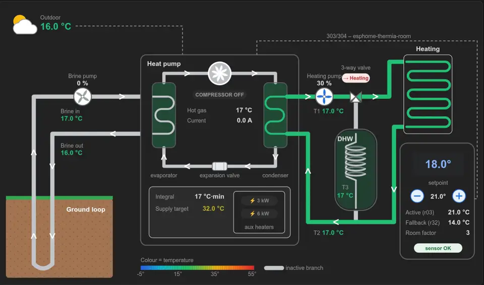

# Thermia heat pump card

[](https://buymeacoffee.com/mdepa91)

A Home Assistant Lovelace card that draws a Thermia / Danfoss ground-source heat pump and shows how it works right
now. It covers the ground loop, the refrigerant circuit with the compressor, the 3-way valve, floor heating, the
hot water tank and the room sensor. Pipes are coloured by temperature, the compressor and pumps spin while they
run, and the room setpoint can be changed with − / +.

Made for [esphome-thermia](https://github.com/mdepa91/esphome-thermia) (pump registers over the EXT port) and
[esphome-thermia-room](https://github.com/mdepa91/esphome-thermia-room) (room sensor emulation). It works with any
entities, though: it only needs their entity IDs.



*Recorded on a real Thermia pump: the compressor starts, the refrigerant circuit and the supply line warm up, and
the colours follow the temperatures live.*

## Features

- **Pipe colours follow the temperature**, on a scale from −5 °C (blue) to 55 °C (red). The branch the 3-way valve
  does not use turns grey, and so do pipes whose pump is stopped.
- **The refrigerant circuit** (evaporator → compressor → condenser → expansion valve) is coloured from the brine,
  hot gas and return temperatures, and turns grey when the compressor stops.
- **Animation:** the compressor fan and the pump impellers spin while they run.
- **Setpoint:** the − / + buttons change the room setpoint. Quick repeated clicks are sent as one
  `number.set_value` call.
- **Click a value, its label or its icon** to open the more-info dialog of its entity.
- **Aux heaters** are drawn in the supply line before the heating pump, with the total power on (0 / 3 / 6 / 9 kW).
- **Polish and English**, chosen automatically from the Home Assistant language, or forced with `language:`.
- **Follows the HA theme** (light / dark) for backgrounds, frames and text.
- **Picks the entities for you:** choose the ESPHome device and the card fills in the entities. It uses the card
  map published by esphome-thermia / esphome-thermia-room, and falls back to keywords in the entity names (PL / EN).
- **Visual editor:** entity lists grouped like the drawing and limited to the chosen device. The editor also gives
  the card the *Layout* tab in Sections views (full width, height).

## Installation

**HACS:** HACS → ⋮ → Custom repositories → add `https://github.com/mdepa91/ha-thermia-heatpump-card` as type
*Dashboard*. Install it, then reload the browser.

**Manually:** copy `dist/thermia-heatpump-card.js` to `config/www/`, then add it under Settings → Dashboards → ⋮ →
Resources as `/local/thermia-heatpump-card.js` (type *JavaScript module*).

## Configuration

Add the card from the dashboard editor ("Thermia heat pump") and pick the **ESPHome device** – the entities are
filled in automatically and can be adjusted. In YAML, `device:` alone is enough as well:

```yaml
type: custom:thermia-heatpump-card
device: 0123456789abcdef0123456789abcdef   # device id (Settings → Devices → the device; it is in the URL)
```

### Automatic entity detection

1. **Card map from the firmware.** esphome-thermia and esphome-thermia-room publish a diagnostic select
   (*Thermia card map*, *Thermia room card map*). Its options list every configured entity as
   `<config key>=<entity name>`, so the card finds each entity whatever it is named.
2. **Keywords** for whatever is still missing, for example with older firmware: Polish and English words in the entity
   names (`DŹ wejście` / `Brine in`, `Zasilanie` / `Supply`, …), plus the entity domain and a few attributes.

Entities given explicitly under `entities:` always win over detected ones. If you rename an entity in Home
Assistant, the map can no longer find it; the keywords usually still do, otherwise set it by hand.

### Explicit entities

Or list the entities yourself:

```yaml
type: custom:thermia-heatpump-card
title: Heat pump            # optional
language: pl               # optional: pl | en, default = Home Assistant language
entities:
  outdoor: sensor.thermia_temp_outdoor
  heatstop: number.thermia_setting_heating_stop_temp
  brine_in: sensor.thermia_brine_in
  brine_out: sensor.thermia_brine_out
  brine_pump: binary_sensor.thermia_brine_pump
  brine_pump_speed: sensor.thermia_brine_pump_speed
  compressor: binary_sensor.thermia_compressor
  hot_gas: sensor.thermia_hot_gas
  current: sensor.thermia_current
  aux_3kw: binary_sensor.thermia_aux_3kw
  aux_6kw: binary_sensor.thermia_aux_6kw
  integral: sensor.thermia_integral
  supply: sensor.thermia_supply_t1
  return: sensor.thermia_return_t2
  supply_target: sensor.thermia_supply_target
  supply_pump: binary_sensor.thermia_supply_pump
  supply_pump_speed: sensor.thermia_supply_pump_speed
  hotwater_production: binary_sensor.thermia_hotwater_production
  hotwater: sensor.thermia_hotwater_t3
  room_temperature: number.thermia_room_temperature
  setpoint: number.thermia_room_setpoint
  indoor_target: sensor.thermia_indoor_target
  fallback_setpoint: number.thermia_setting_indoor_temp
  room_factor: number.thermia_room_factor
  alarm_indoor_sensor: binary_sensor.thermia_alarm_indoor_sensor
```

Every key is optional. A missing or unavailable entity shows `—`.

**Size:** the drawing keeps its proportions (about 1030 × 600), so its height follows the width the dashboard gives
the card. The card asks for the full width of its section, but in a *Sections* view a section is a narrow column by
default. Widen the section with `column_span`, or put the card in a *Panel* view:

```yaml
views:
  - type: sections
    max_columns: 4
    sections:
      - type: grid
        column_span: 3      # 2-4; in the UI: edit section → width
        cards:
          - type: custom:thermia-heatpump-card
            entities: { ... }
```

| Key | esphome-thermia / esphome-thermia-room | Shown as |
|---|---|---|
| `outdoor` | `temp_outdoor` | Outdoor temperature |
| `heatstop` | `setting_heating_stop_temp` | "heat stop ≥ 17 °C" under the outdoor temperature, orange while the outdoor temperature is at or above it |
| `brine_in`, `brine_out` | `temp_brine_in`, `temp_brine_out` | Ground loop pipes |
| `brine_pump`, `brine_pump_speed` | `brine_pump`, `brine_pump_speed` | Brine pump (on/off, %) |
| `compressor` | `compressor` | Compressor (spins when on) |
| `hot_gas`, `current` | `temp_hot_gas`, `current` | Values next to the compressor |
| `aux_3kw`, `aux_6kw` | `aux_3kw`, `aux_6kw` | Heater in the supply line, total kW above it |
| `integral` | `integral` | Integral (red when negative) |
| `supply`, `return`, `supply_target` | `temp_supply`, `temp_return`, `temp_supply_target` | T1, T2, supply target (with the current T1 in brackets) |
| `supply_pump`, `supply_pump_speed` | `supply_pump`, `supply_pump_speed` | Heating pump (on/off, %) |
| `hotwater_production` | `hotwater_production` | 3-way valve: on = hot water, off = heating |
| `hotwater` | `temp_hotwater` | T3 in the tank |
| `room_temperature` | `room_temperature` (thermia_room) or `temp_indoor` | Room sensor display |
| `setpoint` | `setpoint` (thermia_room) – a `number` | Setpoint with − / + buttons |
| `indoor_target` | `temp_indoor_target` | Target the pump uses (r03) |
| `fallback_setpoint` | `setting_indoor_temp` | Pump's own setpoint (r32) |
| `room_factor` | `setting_room_factor` | Room factor |
| `alarm_indoor_sensor` | `alarm_indoor_sensor` | "sensor OK" / "sensor ALARM" |

A pump counts as running if its binary sensor is on. Without one, it counts as running when its speed is above 0.

## Performance

- The card does not poll. Home Assistant hands it every state change in the whole system, and the card redraws
  only when one of its own entities has changed. How often the values change depends on the integration:
  esphome-thermia publishes them every `update_interval`.
- The spinning icons rotate at 30 frames per second instead of 60. A card with three spinning icons costs about
  2.5 % of one CPU core in Chromium without GPU acceleration. The animation pauses while the card is off
  screen, and stops completely with the system setting "reduce motion".

## Development

```sh
python3 build.py            # regenerates src/heatpump.svg and writes dist/thermia-heatpump-card.js
```

- `src/schematic.py` draws the SVG and is the single source of the picture. Every dynamic element has an `id`, and
  every label has a `data-i18n` key.
- `src/card.js` is the card logic and the PL / EN texts.
- `test/index.html` renders three scenarios with a fake `hass` object. `test/render.py` screenshots them in Chromium
  and checks the buttons and the more-info dialog:

  ```sh
  docker run --rm -v $PWD:/w -w /w mcr.microsoft.com/playwright/python:v1.58.0-jammy \
    sh -c "pip install -q playwright==1.58.0 && python3 test/render.py"
  ```

## Polski

Karta Lovelace z rysunkiem pompy ciepła Thermia / Danfoss. Pokazuje dolne źródło, obieg czynnika ze sprężarką,
zawór trójdrogowy, ogrzewanie podłogowe (CO), zasobnik CWU i czujnik pokojowy. Rury mają kolor zależny od
temperatury, a sprężarka i pompy obracają się, gdy pracują. Temperaturę zadaną zmienia się przyciskami − / +, a
kliknięcie wartości otwiera szczegóły encji. Język (PL / EN) dobiera się automatycznie według ustawień Home
Assistanta albo przez `language:`. Konfiguracja: sekcja *Configuration* wyżej; klucze odpowiadają encjom z
esphome-thermia i esphome-thermia-room.

## License

[MIT](LICENSE)
